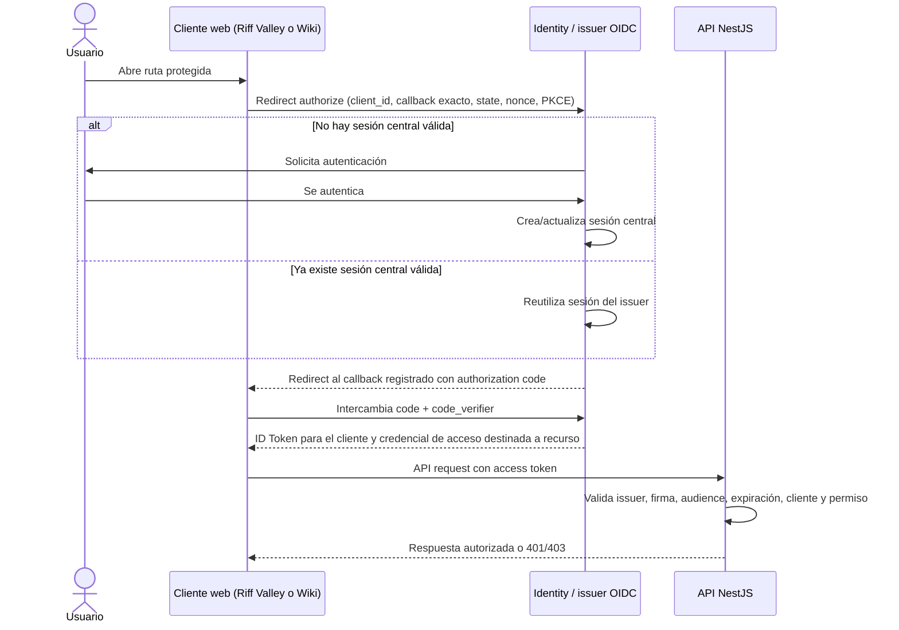
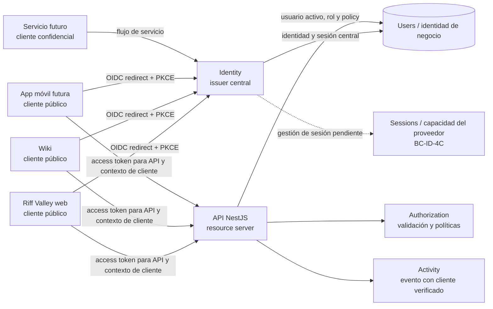

# ADR BC-ID-4B — Evaluación de SSO y decisión posterior de coste cero

**Estado:** BC-ID-4B completada como investigación; su recomendación provisional de OIDC fue sustituida posteriormente por una decisión de producto de coste adicional cero. BC-ID-4C completada como diseño de sesiones propias en [identity-sessions-model.md](identity-sessions-model.md), BC-ID-4D como política de seguridad y revocación en [identity-session-security.md](identity-session-security.md), y BC-ID-4E como contratos/plan de migración en [identity-session-contracts-and-rollout.md](identity-session-contracts-and-rollout.md). BC-ID-4 general queda completada únicamente como fase documental; BC-ID-5A–5C están completadas como persistencia, operaciones internas y validación PostgreSQL, sin activar sesiones. BC-ID-5D–10 y BC-ID-3F siguen pendientes. Este documento conserva el análisis OIDC como antecedente.

**Alcance:** investigación, evaluación y documentación de la decisión vigente. No implementa código, OIDC, protocolo SSO, endpoints, módulos ni infraestructura.

**Nota histórica:** las secciones siguientes que describen issuer OIDC, clientes registrados, redirects, flujos y comparativa A/B/C registran la evaluación realizada en BC-ID-4B. No son requisitos actuales ni una selección pendiente; la dirección vigente está en “Decisión de producto vigente” y al cierre de este ADR.

## Decisión de producto vigente

La prioridad es **no aumentar el gasto mensual de infraestructura o autenticación**. No contratar proveedores OIDC de pago; no desplegar Keycloak, Authentik u otro servicio que requiera servidor adicional; no ampliar dynos, bases de datos ni recursos de Heroku sin aprobación explícita; no introducir suscripciones, licencias o servicios externos de autenticación. Se prioriza evolucionar la autenticación existente en NestJS y reutilizar PostgreSQL, midiendo consumo, límites y capacidad antes de comprometer este diseño.

La autenticación propia existente será la arquitectura objetivo inmediata, ampliada con sesiones. Esto **no es un proveedor OIDC completo ni SSO estandarizado**. Riff Valley y Wiki seguirán siendo clientes separados y requerirán login independiente. Se mantiene la integración actual con la API durante la transición. No habrá redirecciones OIDC ni protocolo SSO casero para compensar la ausencia de proveedor. OIDC puede reevaluarse más adelante si cambian prioridad y presupuesto.

Se mantienen registro público previsto para 2027 (`/api/auth/register`), credenciales actuales, sesiones persistentes hasta 30 días, access JWT con vida objetivo de 15 minutos, refresh con rotación/revocación, renovación automática, restauración tras cerrar navegador, protección de credenciales, revocación de seguridad y permisos actuales. El diseño, seguridad y contratos están en BC-ID-4C–4E. No se presume que su carga quepa sin medición; el modo de sesión queda bloqueado por las verificaciones de topología/HTTPS/cookie y capacidad indicadas en el plan 4E.

Logout de Riff Valley y Wiki es local e independiente. Cada cliente podrá solicitar revocación de su sesión correspondiente; una operación administrativa/de seguridad podrá revocar todas las sesiones del usuario. Ninguno de esos contratos requiere que el logout de una aplicación cierre la otra.

## Recomendación original de BC-ID-4B (supersedida; conservar como antecedente)

La evaluación original recomendó **OpenID Connect como arquitectura objetivo**, con Identity como issuer central y Authorization Code + PKCE para clientes públicos. Cada app se habría registrado por separado y NestJS habría actuado como resource server, conservando `Users` como dominio de negocio. Esa recomendación fue provisional y ya no representa la dirección de producto vigente.

La recomendación original fue usar un proveedor OIDC estándar en vez de desarrollar un protocolo de SSO propio. La elección entre proveedor autogestionado y gestionado quedó abierta por falta de confirmación de dominios/orígenes reales, hosting y staging, operación disponible, requisitos de privacidad/residencia, integración con usuarios actuales y coste. BC-ID-4A no verificó esos datos; la decisión posterior de producto sustituye esta recomendación.

El proveedor debe ser una **autoridad lógica y un issuer identificable**. Se recomienda que sea una unidad de despliegue independiente del API para aislar claves, actualizaciones, disponibilidad y responsabilidades. Podría alojarse en la misma cuenta/plataforma que el backend si la plataforma satisface esos requisitos; que el alojamiento actual lo permita sigue sin verificar. “Independiente” describe el límite del componente, no obliga a un dominio o proveedor de hosting concreto.

Como patrón de integración, conservar `Users` como registro de negocio y vincular cada identidad autenticable a un `sub` estable del issuer, preferiblemente mediante `User.id` o una asociación inmutable y única. Se puede delegar autenticación en un proveedor sin duplicar el dominio de usuario, siempre que resuelva aprovisionamiento, vinculación, estados y credenciales sin exigir un cambio de contraseña. La compatibilidad con los hashes bcrypt existentes no está demostrada: debe probarse con el proveedor elegido o diseñarse una transición de credenciales que no exponga hashes ni fuerce un reset general.

La ruta pública `/api/auth/register` se conserva como requisito de producto para la apertura prevista en 2027. En la evaluación BC-ID-4B no se decidieron su implementación ni su respuesta. El contrato propio de sesión y la transición legacy quedaron definidos posteriormente en BC-ID-4E; la retirada se reserva a BC-ID-9. La hipótesis histórica de proveedor habría requerido crear/vincular su identidad con la cuenta de negocio y concretar errores parciales/rollback.

## Contexto confirmado y límites heredados de BC-ID-4A

- Riff Valley y Wiki son proyectos separados. Ambos consumen una API configurada con `VITE_API_BASE_URL`, pero hoy guardan JWT distintos en `localStorage`; no comparten estado de navegador ni existe SSO.
- `app.riffvalley.es` y `wiki.riffvalley.es` aparecen en CORS, pero no están confirmados como despliegues activos. Si fueran las URLs reales bajo HTTPS, serían orígenes distintos del mismo dominio registrable. El origen de la API, TLS efectivo, proxies y hosting de Wiki siguen desconocidos.
- La API actual emite JWT de ocho horas mediante `/api/auth/login` y `/api/auth/register`; el token actual no identifica issuer, audience ni cliente. CORS permite credentials, pero los clientes observados usan `Authorization: Bearer`, no cookies.
- No se consultaron sitios, servicios, documentación de proveedores, secretos ni precios. La comparación es cualitativa y no atribuye funciones a un proveedor concreto.

## Clientes y registro

| Cliente | Tipo de cliente | Registro y redirect | Política de acceso |
|---|---|---|---|
| Riff Valley web | Público: el código distribuido al navegador no puede custodiar un secreto. | `client_id` propio; allowlist exacta de callbacks por entorno, sin patrones amplios ni URLs derivadas de parámetros; registrar también los destinos de logout si el proveedor los soporta. | Scopes mínimos para la app y sus APIs; no confiar en permisos de interfaz como autorización del servidor. |
| Wiki web | Público e independiente de Riff Valley. | `client_id` distinto; callbacks exactos y separados por entorno. No reutilizar el registro de Riff Valley ni asumir cookie/storage compartido. | Política Wiki propia: `collaborator` o superior, además de scopes/audience destinados al uso de Wiki. Una sesión SSO por sí sola no otorga acceso. |
| Futuras aplicaciones web | Públicas si ejecutan el flujo en un navegador sin backend confidencial; algunas arquitecturas pueden tener también un backend propio. | Registro individual, callbacks HTTPS exactos en producción y callbacks locales limitados a desarrollo. Aprobación controlada, dueño, propósito y lista de recursos/scopes. | Permisos mínimos por aplicación; scopes no amplían roles de otra app. |
| Aplicación móvil nativa | Pública; no incluir client secret en el binario. | `client_id` por aplicación/plataforma según la política que se apruebe; Authorization Code + PKCE en navegador del sistema y callback de app verificado (Universal/App Links o URI scheme sujeto a evaluación). | Access token dirigido a su API/recursos; permisos móviles independientes. Evitar WebView embebido como agente de autenticación. |
| Servicio backend a backend | Confidencial solo si puede guardar y rotar sus credenciales en un entorno servidor controlado. | Registro y credenciales exclusivos por servicio/ambiente; no compartir client secret entre servicios. | Flujo de máquina a máquina y scopes limitados a su función. La delegación en nombre de usuario es un caso distinto y requiere un flujo explícito; no reutilizar tokens de navegador. |

`client_id` identifica una aplicación registrada, no demuestra por sí solo quién envió una petición: un cliente público puede copiarse. La API debe validar el token y obtener de claims firmados o de introspección el cliente autorizado, emisor y destinatario. `Origin` puede ser defensa web complementaria, no identidad criptográfica de cliente ni una prueba suficiente para BC-ID-3F. El contrato propio de 4E usa flujo reconocido + allowlist Origin para vincular `clientType` a la sesión y claim firmado; registra la limitación de SPA pública.

Las redirect URIs deben compararse exactamente contra registros aprobados, sin comodines de producción ni redirects abiertos. Separar registros/configuración de producción, staging y desarrollo evita callbacks o secretos compartidos accidentalmente. El aprovisionamiento de clientes debe ser administrativo y auditable; no se habilita autorregistro dinámico de clientes públicos. En una SPA que canjea el code desde el navegador, el token endpoint del issuer puede requerir CORS para esos orígenes; si el proveedor no soporta ese perfil, evaluar un BFF/componente servidor en vez de insertar un secreto en el bundle.

## Estándares y separación de credenciales

- Para clientes públicos, evaluar OIDC Authorization Code + PKCE con `S256`. El flujo requiere `state` ligado a la transacción y validado al callback; validar `nonce` cuando se solicite un ID Token y comprobar firma, issuer, audience y tiempos del token. Los requisitos definitivos y pruebas de conformidad se detallarán con el proveedor en BC-ID-4E.
- El issuer elegido debe poder satisfacer sesiones persistentes con un máximo absoluto de 30 días y renovación automática como requisitos de producto. Este corte no fija duración de access token, inactividad, cookie ni rotación del refresh token; esos detalles son de BC-ID-4C.
- El ID Token acredita autenticación al cliente OIDC y su `aud` debe corresponder a ese `client_id`; **no es un bearer token para la API**. El access token se dirige al resource server/audience previsto. Si una API atiende a más de una aplicación, el token también debe permitir identificar de forma validable el cliente autorizado (por claim estandarizado soportado o mecanismo equivalente) y limitar scopes. No fijar aquí claims privados ni el contrato HTTP.
- No pasar el token de Riff Valley a Wiki ni el de Wiki a Riff Valley. Cada cliente realiza su propio redirect al issuer y recibe sus propias credenciales, dirigidas a sus recursos. No compartir `localStorage`, refresh token ni secretos entre clientes.
- Mantener cuatro conceptos separados: identidad estable del usuario; sesión central del issuer; sesión/estado local de cada aplicación; autorización y credenciales dirigidas a cada cliente/recurso. La autorización se vuelve a comprobar en backend. Roles de interfaz o claims decodificados por el navegador no son autoridad.
- El flujo de servicios confidenciales se separa de los clientes públicos. No se incluye ningún secreto en frontend o aplicación móvil. La gestión de secretos de servicio debe usar almacenamiento de servidor, acceso mínimo y rotación; sus detalles operativos quedan fuera de este corte.

## Flujos conceptuales

El diagrama muestra un código de autorización de un solo uso con PKCE, no un intercambio de tokens entre las dos aplicaciones. La sesión central permite al issuer decidir si pide credenciales en el redirect; cada cliente recibe su resultado por separado.

| Escenario | Resultado arquitectónico esperado |
|---|---|
| Inicio desde Riff Valley | Riff Valley redirige al issuer, completa su callback y crea su propio estado local autenticado. Si el usuario no tiene sesión central, se autentica allí. |
| Abrir Wiki después de Riff Valley | Wiki inicia su propio flujo OIDC. El issuer puede reutilizar su sesión de primera parte y volver a Wiki sin pedir credenciales; entrega un resultado/token propio de Wiki. No lee el storage de Riff Valley. |
| Inicio primero desde Wiki y luego Riff Valley | Mismo flujo en sentido inverso; el issuer reutiliza la sesión central, pero Riff Valley obtiene su propia respuesta y permisos. |
| Usuario autenticado sin permiso de Wiki | La identidad se confirma, pero Wiki/API deniega acceso con 403 o pantalla de acceso denegado. No se rebaja el mínimo `collaborator` ni se repite login como solución a falta de permiso. |
| Sesión central expirada | El siguiente redirect al issuer solicita autenticación; el modelo 4C detiene refresh al expirar la sesión. El efecto sobre access tokens ya emitidos y la propagación visible dependen de BC-ID-4D; no se presupone revocación instantánea. |
| Incorporar un tercer cliente | Registrar `client_id`, callbacks por entorno, tipo, dueño, recursos, scopes y política de acceso. El nuevo cliente realiza su flujo propio; no exige que los clientes existentes compartan origen o storage. |
| Cliente móvil futuro | Aplicar flujo público con Code + PKCE y navegador del sistema; callback verificado; registrar la app y sus recursos de forma independiente. Persistencia/secure storage y logout móvil quedan para 4C/4D. |

## Evaluación de alternativas

La escala cualitativa refleja el patrón arquitectónico, no un producto inspeccionado. “Coste” expresa factores a calcular, no precios.

| Alternativa | Seguridad | Complejidad de implementación | Complejidad operativa | Coste previsto (sin cifras) | Nuevos clientes | Integración con Identity actual | Mantenimiento | Dependencia de terceros | Compatibilidad conocida |
|---|---|---|---|---|---|---|---|---|---|
| **A. Proveedor OIDC autogestionado** | Buena base estándar si se configura, actualiza y opera correctamente; el equipo asume claves, hardening, recuperación y respuesta a incidentes. | Media: integrar issuer, clientes, callback/API y vinculación de usuarios; no construir protocolo. | Alta: hosting y disponibilidad del issuer, DB, copias, upgrades, claves, monitorización y administración de clientes. | Infraestructura y horas operativas; no hay datos para estimar importes. | Alta: registro estándar de web, móvil y servicio. | Puede usar Users como fuente/federación si el proveedor soporta el hash/protocolo requerido; no está confirmado. | Continua y especializada. | Baja respecto al proveedor del protocolo; dependencia del proyecto elegido y del equipo operador. | Dominio del issuer, HTTPS, persistencia, ownership y hosting aún no confirmados. |
| **B. Proveedor OIDC gestionado** | Hereda controles del proveedor y reduce operación propia, pero requiere revisar configuración, garantías, incidentes, datos y salida. | Media: integrar OIDC, clientes, claims, aprovisionamiento y mapeo de usuarios. | Baja a media para infraestructura; sigue habiendo gestión de usuarios, clientes, políticas, soporte y configuración. | Suscripción/uso y costes de integración/salida variables; no se consultaron precios. | Alta si el servicio elegido cubre web, móvil y M2M requerido. | Puede federar o vincular identidades; compatibilidad bcrypt, sincronización y exportabilidad se deben verificar. | Menor operación de plataforma, pero revisión de servicio, cambios y portabilidad permanentes. | Alta y específica del proveedor; mitigable con estándares, mapeo estable y plan de salida. | Faltan requisitos de privacidad/residencia, dominio issuer, callbacks, logout, límites y SLA. |
| **C. Evolución limitada del Identity actual, sin proveedor OIDC** | Superficie de riesgo alta si se implementa handoff, códigos, PKCE/sesiones o tokens propios; cubrir algunos mensajes no equivale a OIDC ni ofrece interoperabilidad/conformidad. | Alta si se pretende SSO real, sesiones, clientes múltiples y seguridad completa; media solo para una solución de alcance restringido que no debe etiquetarse OIDC. | Media-alta: el equipo mantiene protocolo, claves, sesiones, recuperación, clientes y compatibilidad de navegadores. | Desarrollo y mantenimiento interno a largo plazo; sin cifras verificables. | Baja-media: cada cliente nuevo aumenta contratos y pruebas propias. | Reutiliza Users/DB y puede reducir migración inicial; Auth acabaría manteniendo la lógica propietaria. | Alta, incluyendo actualizaciones de seguridad y comportamiento de cliente. | Baja dependencia de un IdP, alta dependencia del equipo y del protocolo interno. | Alojamiento y dominios desconocidos; no resuelve de forma estándar los clientes públicos/móviles. No recomendada como baseline. |

Para que C fuera OIDC de verdad tendría que cubrir el protocolo y su interoperabilidad completa, no solo redirecciones y JWT: discovery/issuer, clientes y callbacks registrados, authorization code, PKCE, estado/nonce, firma y validación de tokens, audiencias, expiración, scopes, sesiones, revocación/logout, errores, protección de redirects y mantenimiento de conformidad. Si se limita a un mecanismo privado, su contrato y garantías serán propios y cada cliente tendrá que depender de ellos; no se presentará como equivalente a OIDC.

### Alternativa híbrida considerada en la evaluación original (no vigente)

La recomendación original combinaba proveedor OIDC (A o B, no elegido) con **Users como dominio de negocio**. El proveedor habría autenticado y conservado la sesión central; el backend, perfiles, estado activo, roles y relaciones de aplicación. Una asociación estable `issuer + sub` ↔ `User.id` habría evitado duplicar el registro de negocio. Esta arquitectura ya no es la dirección actual.

Hay dos formas de conservar credenciales actuales que deben verificarse con el proveedor, sin decidirlas aquí:

1. **Federar contra Users/credenciales actuales:** el proveedor delega autenticación en un mecanismo soportado que valida las cuentas existentes. Evita copiar contraseñas, pero exige integración segura, disponibilidad de la fuente y manejo de `isActive`/bloqueos.
2. **Vincular/importar identidad:** asociar cada cuenta de proveedor a `User.id` y migrar credencial/hash solo si el formato y política del proveedor son compatibles. Si no admite el hash existente, estudiar migración progresiva con autenticación del usuario actual en primer acceso; no forzar reset general ni mantener hashes duplicados indefinidamente sin justificación.

En ambas, asegurar unicidad de la vinculación, usuarios inactivos, cuentas duplicadas, cambio de username/email, eliminación y rollback. Evitar enlazar cuentas automáticamente solo por email sin demostrar control y unicidad. El método y sus efectos sobre registro 2027 quedan para 4E/implementación.

## Responsabilidades en Identity

| Componente | Papel arquitectónico futuro | Límite de esta decisión |
|---|---|---|
| Identity actual en NestJS | Mantener login/credenciales y evolucionar emisión y gestión de sesiones dentro del backend existente, reutilizando PostgreSQL sujeto a medición de capacidad. | No es issuer OIDC; no ofrece ni implementa SSO entre aplicaciones en este alcance. |
| `AuthModule` | Mantener compatibilidad de login/registro y servir de fachada al flujo de sesiones propio diseñado en 4C–4E. | Conservar `/api/auth/login` y `/api/auth/register`; negociación opt-in para modo nuevo; no integrar issuer ni retirar contratos antes de la fase BC-ID-9. |
| `UsersModule` | Fuente de cuenta de negocio, perfil, username/roles/estado para las credenciales y sesiones propias. | Mantener una sola identidad de negocio y no exponer hash de contraseña. |
| `AuthorizationModule` | Validar credenciales emitidas por Auth (firma y expiración) y consultar usuario activo/rol vigente para aplicar permisos de recurso. | La identificación de aplicación para BC-ID-3F debe tener una fuente confiable definida; permisos UI no son autoridad. |
| `ActivityModule` | Registrar aperturas solo con identidad autenticada y contexto de cliente validado, distinguiendo `app` y `wiki`. | El esquema/endpoint y la señal pertenecen a BC-ID-3F u otro corte aprobado, no a este ADR. |
| Futuro `SessionsModule` | Gestionar sesiones persistidas, refresh rotatorio y revocación en NestJS/PostgreSQL según el diseño de BC-ID-4C. | No duplicará proveedor externo; costo/capacidad, almacenamiento y límites deben medirse antes de implementar. |
| `AuthController` y endpoints actuales | Preservar temporalmente rutas/payloads existentes y registro público; facilitar migración aditiva coordinada. | `/api/auth/register` permanece requisito para 2027. Ninguna ruta se elimina ni se redefine en BC-ID-4B. |

### Antecedente del análisis de despliegue OIDC

La evaluación original proponía que un issuer tuviera URL, metadata y gestión de claves independientes del frontend, y recomendaba desplegarlo como unidad lógica separada del API. Esa recomendación queda archivada, no es requisito vigente. BC-ID-4A no confirmó hosting físico ni capacidad de despliegue para ningún proveedor adicional.

Para la dirección actual, BC-ID-4C–4E documentan el consumo que se deberá medir y los fallos/degradación aceptables en API/PostgreSQL existentes, sin asumir ampliaciones. La compra o despliegue de servicios adicionales no está aprobada.

## Decisiones y pendientes

**Decisión actual:** evolución de la autenticación NestJS existente con sesiones gestionadas por la aplicación, usando PostgreSQL y recursos actuales, bajo la restricción de gasto adicional mensual cero. Login/estado de Riff Valley y Wiki son independientes. El presupuesto y la capacidad efectiva deberán verificarse; cualquier ampliación requiere aprobación explícita.

**Historial de BC-ID-4B:** se consideró OIDC porque aporta un estándar interoperable, Authorization Code + PKCE, registro explícito de clientes y un camino claro para móviles y futuros servicios. Se compararon opciones OIDC autogestionadas, gestionadas y la evolución limitada del Identity actual; la alternativa limitada reutilizaba NestJS/Users pero asumía más superficie de seguridad y mantenimiento. La nueva prioridad económica descarta la implementación inmediata de A/B: el servicio gestionado podría añadir suscripción/uso; autogestionar Keycloak, Authentik u otro issuer añade servidor, operación, almacenamiento y mantenimiento. No se estiman cifras ni se afirma el coste concreto de proveedores. La autenticación propia tampoco se etiquetará como OIDC ni como SSO estándar.

**Información útil que se conserva para una futura revisión:** requisitos de PKCE/state/nonce, redirects exactos, separación de cliente/audiencia/permisos, firma/issuer/claves, vinculación de usuarios, amenazas de cookie/CSRF, logout y portabilidad. Son criterios de evaluación futura, no dependencias de 4C–4E actuales.

**BC-ID-4C completada:** el [diseño de sesiones y tokens propios](identity-sessions-model.md) propone sesiones de 30 días no deslizantes, access JWT de 15 minutos, refresh opacos rotatorios con hash en PostgreSQL, revocación por sesión/usuario, restauración web condicionada a cookie segura y limpieza oportunista. BC-ID-4D corrigió su propuesta de recuperar resultados de refresh cifrados: el comportamiento base es rotación atómica de un solo sucesor, y una respuesta perdida puede requerir login. Es solo diseño; no implementa ni asume capacidad ilimitada.

**BC-ID-4D completada:** [la política de seguridad y revocación](identity-session-security.md) define amenazas priorizadas, almacenamiento/cookies condicionados a la topología, CSRF/CORS, concurrencia sin bearer recuperable, reuse, revocación, abuso, costes y 12 escenarios verificables. App y Wiki conservan logout independiente; los JWT emitidos pueden vivir hasta `exp` con los checks actuales de usuario/roles.

**BC-ID-4E completada:** el [plan técnico y de migración](identity-session-contracts-and-rollout.md) define negociación legacy/nuevo sin cambiar rutas existentes, contratos futuros, condiciones de cookie/CORS/CSRF, bloqueos de despliegue, rollback, pruebas/capacidad y cortes pequeños 5A–6D, 7A/B, 8A/B y 3F-A/B/C. Orígenes, HTTPS, proxy y compatibilidad cross-site siguen sin verificarse; el modo sesión no se habilita hasta completar checklist por entorno/cliente. BC-ID-5A–5C —persistencia, operaciones internas y validación PostgreSQL— están completadas sin activar el flujo de sesiones; sus resultados están en el cierre de 5C del plan técnico.

**BC-ID-5B completada:** implementa operaciones internas transaccionales para crear, rotar y revocar sesiones y detectar reuse, sin endpoints. **BC-ID-5C/5D completadas:** garantías PostgreSQL, auditoría redactada y limpieza acotada verificadas. **BC-ID-6A completada:** Auth compone internamente credenciales activas, selección de cliente por Origin configurado, sesión y JWT corto; el controlador no expone el modo, y cookies/refresh HTTP no se activan. **BC-ID-6B–6D, 7A/B, 8A/B y 3F-A/B/C** siguen pendientes. Las sesiones no están activas públicamente. BC-ID-4 está cerrada como fase de diseño, no como autorización general de implementación.

El análisis OIDC de este ADR mantiene la recomendación histórica como antecedente; la decisión vigente es el diseño propio de [BC-ID-4C — sesiones y tokens](identity-sessions-model.md), [BC-ID-4D — seguridad y revocación](identity-session-security.md) y [BC-ID-4E — contratos y migración](identity-session-contracts-and-rollout.md). El diseño no reabre OIDC ni exige SSO. BC-ID-4 general está completa únicamente como fase de diseño; la implementación 5–10/3F permanece pendiente.
