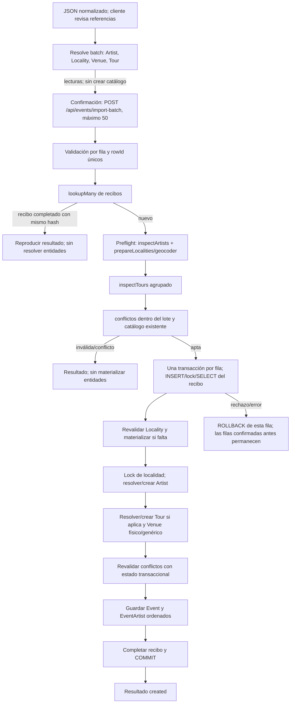
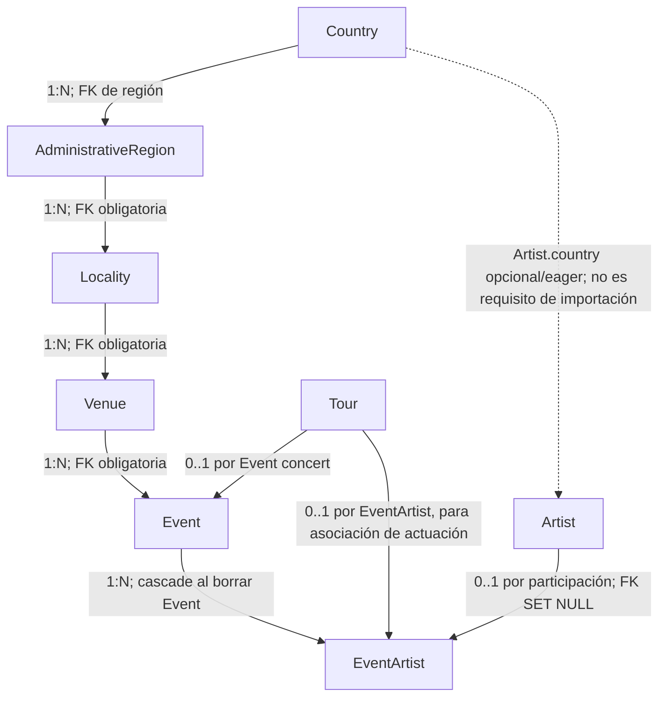

# CON-F12d — Auditoría del flujo de importación masiva

**Estado:** auditoría y diseño. No implementa cambios de backend o frontend, no crea endpoints y no marca CON-F12d como implementación completada.

## Alcance y fuentes

Revisión de `EventsController`, `EventsImportBatchService`, resolutores de Artist/Locality/Venue/Tour, motor de conflictos, recibos, DTOs, entidades y migraciones de `Country`, `AdministrativeRegion`, `Locality`, `Venue`, `Artist`, `Tour`, `Event` y `EventArtist`. El importador actual admite hasta 50 filas HTTP y las procesa en secuencia. Para el detalle de CON-F12b/12c y mediciones históricas, véanse [import-audit.md](import-audit.md) y [import-performance.md](import-performance.md).

Se considera “previsualización” la revisión cliente que consume resolutores de lectura y el preflight sin escritura ejecutado dentro de `import-batch`. No se encontró un endpoint backend único que reciba el archivo completo y emita un plan global persistido.

## 1. Flujo actual

### Previsualización y confirmación

- Los endpoints `POST /api/artists/resolve-batch`, `POST /api/localities/inspect-batch`, `POST /api/venues/resolve-batch` y `POST /api/tours/resolve-batch` hacen lecturas agrupadas y no reservan IDs. El inspector de localidad tampoco llama al geocoder. `POST /api/localities/resolve` es otra operación, protegida, que geocodifica/materializa una sola localidad; no es el camino del importador por lote.
- Estos cuatro resolutores admiten hasta 100 entradas por request. Para un archivo de 600, la confirmación son 12 requests de importación. Si el cliente consulta los cuatro resolutores con 600 entradas cada uno, serían hasta 24 requests extra (6 por resolutor); si consulta solo referencias únicas o no necesita un resolver, bajan según `ceil(entradas/100)`. El backend no registra el número real de requests del cliente ni se modificó el frontend para medirlo.
- Al confirmar, el backend valida DTO, fechas y rowIds; consulta recibos existentes en una query. Una repetición completa de recibo termina aquí y no vuelve a resolver referencias.
- Para filas nuevas, Artist se inspecciona por claves normalizadas en bloque. `prepareLocalities` deduplica identidades de entrada dentro del request y prepara una localidad nueva con geocodificación, sin insertarla. La geocodificación es una integración externa/fixture, no una escritura SQL.
- Tours del lote se inspeccionan agrupados. Después `ImportConflictsService.inspect` compara filas del lote y candidatos existentes (consultas SQL agrupadas en grupos de hasta 25 filas).
- Solo filas aún aptas reservan recibo y abren transacción individual. Dentro se vuelven a leer referencias y conflictos, y se materializan referencias necesarias. Event, EventArtist y recibo se confirman juntos. Fallar una fila revierte sus cambios, no las filas previas ya confirmadas.
- Los fallos de infraestructura en preflight afectan las filas pendientes; durante persistencia detienen el procesamiento posterior del request. El cliente puede reenviar exactamente el mismo lote: los recibos completados reproducen eventos ya confirmados, y filas no confirmadas vuelven a intentarse.

### Operaciones de lectura y escritura

| Entidad | Inspección previa | Persistencia actual | Decisión/condición |
|---|---|---|---|
| Country | Se valida por el `countryId` enviado; los endpoints de inspección geográfica cargan IDs de país en bloque. | No se crea ni se modifica al importar. | Debe existir antes; no hay referencia provisional segura para FK de localidad. |
| AdministrativeRegion | Resolución de nombres/IDs durante inspección de localidad y comprobación del contexto al preparar localidades nuevas. | No se crea durante importación. | Para localidad nueva se requiere un `administrativeRegionId` ya existente y perteneciente al país. |
| Locality | Busca nombre/alias y contexto; IDs explícitos se validan junto a Venue, región y país. Si es nueva, consulta región y geocodifica una vez por identidad distinta del request. | Relectura en la transacción; advisory lock de identidad geográfica; inserción `ON CONFLICT DO NOTHING`; aliases guardados después del insert. | Automática solo si contexto/geocodificación son válidos; si hay ambigüedad o geocoder no disponible, fila inválida. |
| Venue | `resolve-batch` lee candidatos cuando ya hay localidad persistida. En el importador, la comprobación exacta ordinaria se hace al materializar. | ID explícito revalidado; si falta nombre, se reutiliza/crea Venue genérico; si hay nombre, advisory lock y `createImportVenue`. | Automática al importar; el único Venue genérico por localidad y los Venues físicos tienen unicidad parcial. |
| Artist | Búsqueda agrupada por variantes normalizadas, o validación de ID explícito; puede detectar ambigüedad. | En cada fila se toma advisory lock por clave musical, se reconsulta y se reutiliza o crea con `needsReview=true`. | Artista desconocido se crea automáticamente solo si la fila llega a persistencia. No hay clave única histórica para Artist; lock serializa importadores cooperantes. |
| Tour | Lectura agrupada por `normalizedName`; existencia exige `tourId` confirmado. | Relectura transaccional; la creación usa lock por nombre e índice único. | Tour desconocido se crea para fila tipo `tour`; Tour existente no se acepta sin ID explícito coincidente. |
| Event | Candidatos por localidad, periodo y lineup; comparación de duplicados/conflictos en lote. | Revalidación bajo lock por localidad; `INSERT` de Event. | No hay clave única semántica que represente un evento; el conflicto de aplicación evita carreras cooperantes. |
| EventArtist | Lineup de candidatos cargado en orden para comparar. | Se guarda el array de participaciones en una operación por Event, con posiciones 1..N. `EventArtist.tourId` actualmente queda null en este flujo. | FK de Artist nullable; orden preservado por posición única por evento. |

### Relaciones, constraints y protección

No se observa FK `Event → Country` o `Event → AdministrativeRegion`: el país y la región del evento se derivan por `Venue → Locality → AdministrativeRegion → Country`. La entidad Country no tiene índice de nombre único en el modelo revisado; `AdministrativeRegion` tiene unicidad `(countryId, nameNormalized)` y `(countryId, code)`; Locality tiene unicidad geográfica `(administrativeRegionId, provinceNormalized, nameNormalized)` y referencia OSM; Venue tiene unicidad parcial `(localityId, nameNormalized)` físico y una fila genérica por localidad; Tour es único por `normalizedName`; EventArtist es único por `(eventId, position)`. Event no tiene unicidad semántica. Artist tampoco declara unicidad de nombre normalizado.

Las FKs `RESTRICT` de Region→Country, Locality→Region, Venue→Locality, Event→Venue/Tour y EventArtist→Tour, junto con las unicidades, son la autoridad estructural. El importador añade recibo único `(editorId,batchId,rowId,operation)` con `FOR UPDATE`, locks advisory transaccionales para Locality, Artist, Venue, Tour y los conflictos de Event por localidad, además de relecturas después de bloquear. Los locks no son una sustitución de FK/índices; el análisis preliminar fuera de transacción puede quedar obsoleto.

**Confirmación del usuario:** Country/Region IDs deben ser válidos; Region se necesita para crear Locality. Una Locality/Venue ID enviada por el cliente se comprueba contra los nombres/contexto; ID desactualizado o incompatible es inválido y no cae a búsqueda alternativa. Artist ambiguo debe resolverse con selección explícita `artistId`. Tour existente requiere `tourId` confirmado; si su nombre ya existe, omitir el ID bloquea la fila. No se crean Country ni Region durante importación.

## 2. Comparación de estrategias

| Dimensión | A — Materialización previa global | B — Materialización durante cada lote/fila (actual) | C — Híbrida propuesta |
|---|---|---|---|
| HTTP | Resolver todas las referencias una vez por archivo (hasta 24 requests para 4 grupos de 600 entradas en los endpoints actuales), luego 12 confirmaciones; materializar referencias requeriría nuevo contrato si debe ser una operación backend global. | Resolutores del cliente más 12 `POST /import-batch`; cada request vuelve a inspeccionar su conjunto. | Reutilizar resolutores existentes/deduplicación de archivo y conservar 12 confirmaciones; no requiere enviar 600 eventos en una llamada. |
| SQL | Búsqueda inicial agrupada eficiente, pero escrituras SQL de entidades que quizá no llegue a usar ningún evento aceptado. El preflight no ofrece hoy una transacción global. | Lecturas agrupadas por request; SQL transaccional y materialización solo para cada fila persistible. Repeticiones entre 12 lotes generan lecturas repetidas. | Deduplicación/lectura inicial reduce repetición en preparación; revalidación y lecturas críticas siguen dentro de cada transacción. Caché solo de IDs ya confirmados. |
| Escrituras/transactions | Inserta Artist/Locality/Venue/Tour sin el Event dueño; nuevas transacciones y estado comprometido antes de evento. Puede dejar catálogo huérfano tras rechazo/fallo. | Una transacción por Event incluye nuevas referencias, EventArtist y recibo; rollback completo de la fila. | Igual que B; entidades nuevas se materializan solo para fila aprobada, en su transacción. |
| Locks/integridad | Locks y relecturas en fase previa protegen identidad de catálogos pero no ligan esas escrituras a decisión/conflicto del Event. Después se requiere revalidar igual. | Un lock por identidad se mantiene en transacción; protege carreras locales y de catálogos sin transacción por archivo. | Igual que B; precarga nunca sustituye checks, locks, FKs o unique indexes de commit. |
| Memoria | Plan y mapas globales de hasta 600+ referencias; pequeño para hoy, lineal con archivo. | Máximo 50 filas en DTO y resolución a la vez; menos estado retenido por request. | Mapa de claves/IDs del archivo en cliente o plan ligero; backend mantiene memoria acotada por 50. |
| Duplicados/fallos | Puede crear referencias para duplicados, eventos ya existentes, conflictos o filas que después no se confirman. Recuperación difícil porque precreación quedó comprometida. | Conflictos se detectan antes de persistir; duplicado de recibo replays sin escritura. Un fallo a mitad conserva filas anteriores; retry es seguro por recibo. | Detectar elegibilidad/duplicados antes de materializar; sólo confirmar refs tras validar estado actual. Mantener idempotencia por fila y semántica de retry de B. |
| Carrera | Aumenta ventana entre preparación global y eventos; necesita segunda validación transaccional. | Ventana entre preflight y fila cerrada por locks y segunda comparación. | Mismo requisito; pre-resolución es una sugerencia, el ID se revalida al persistir. |
| Contrato | Nuevo endpoint o extensión para plan/materialización masiva, y política de entidades preparadas sin eventos. | Contratos actuales: lotes 50, fila independiente, estados `created/conflict/invalid/failed`, IDs y recibos. | Resolución global cabe en resolutores actuales y confirmación en import-batch; para omitir “sin cambios” con estado explícito hace falta ampliar resultado, no otro endpoint de materialización. |
| Heroku Basic / essential-0 | Puede bajar tiempo por lote a costa de más operaciones, locks/commits y catálogo huérfano; coste no justificado por prioridad de velocidad. | Presión acotada y secuencial; llamadas repetidas suman CPU/SQL, pero cargas de 600 actuales ya tienen medición local. | Reduce trabajo redundante sin ensanchar transacciones. Ofrece mejor equilibrio si los IDs caché se confirman solo tras commit y siempre se revalidan. |

**Conclusión:** no conviene crear previamente entidades del catálogo. Mantener la materialización diferida de B dentro de la transacción del Event, y adoptar solo la parte segura de C: deduplicar las referencias de todo el archivo durante la revisión, enviar IDs existentes explícitos y evitar repetir resolución/geocodificación idéntica en el cliente. En backend, reutilizar resultados por claves normalizadas dentro del lote/archivo únicamente como candidatos; usar IDs inmutables de operaciones ya confirmadas y volver a comprobar vigencia/contexto bajo la transacción de cada Event. Esto reduce consultas evitables sin dar por vigente una previsualización obsoleta.

## 3. Duplicados, “sin cambios” y campos semánticos

### Qué detecta el backend actual

- `rowId` duplicados dentro del mismo request son `invalid` antes de consultar recibos. Recibos anteriores con el mismo editor/lote/fila y el mismo hash reproducen el resultado; contenido distinto o estado incompleto es conflicto de idempotencia.
- `ImportConflictsService` encuentra duplicados/conflictos entre filas del lote y eventos existentes. Concert/tour se comparan como participación por localidad, fecha inicial y artista; un concierto con todos los artistas resueltos ya asociados se reporta `CONCERT_DUPLICATE`. Festival idéntico usa nombre, localidad y periodo; solapamiento con nombre/localidad iguales es posible duplicado. La participación con festival solo considera festivales de un día.
- Venue no cambia el resultado de conflicto de concierto. Tour no participa en esa identidad semántica; se resuelve/crea por nombre normalizado y la fila tipo `tour` crea Event concert con `Event.tourId`. `price` y `otherInfo` tampoco participan en conflictos.
- El analizador no es una comparación de igualdad del payload entero: el lineup del Event persistido se carga ordenado para mostrar/analizar artistas, pero una permutación de los mismos artistas no convierte por sí sola el evento en cambiado. El lineup entrante mantiene orden al guardarse.

### Determinar “sin cambios” antes de materializar

El backend puede encontrar un Event candidato por su información de identidad y cargar los campos de Event, Venue/Locality/Region/Country, EventArtist en orden y Tour necesarios para comparar antes de crear referencias nuevas. Pero el resolver actual no devuelve un Event canónico con todos esos campos ni implementa una comparación de igualdad; el conflicto actual solo da candidato/participación. Por tanto, hoy no puede afirmar “sin cambios” con fidelidad semántica sin añadir una consulta/proyección y política explícita. No llamar al geocoder para una localidad ya identificada y no materializar artistas antes de la resolución son optimizaciones existentes; para referencias nuevas se usa identidad provisional al analizar conflictos del request.

Una comparación futura debe ser direccional y por presencia: campos omitidos por la fuente significan “no comparar/no solicitar modificación”, no borrar. Si el contrato de scraper declara un snapshot completo, esa política debe explicitarse aparte antes de interpretar ausencia como vacío. Semántica propuesta:

| Campo | Comparación segura propuesta |
|---|---|
| Tipo | Igualdad exacta de `concert`/`festival`; input `tour` representa Event concert + Tour enlazado. |
| Artistas | Resolver a IDs existentes cuando sea inequívoco; para nuevas identidades comparar clave musical provisional. Comparar conjunto y orden por `position` solo si el importador define orden de lineup como contenido fuente. No reordenar automáticamente. Artist ambiguo impide afirmar igualdad. |
| Fecha | Comparar `startDate` y `endDate` con semántica explícita: `endDate` ausente y null equivalen actualmente al evento de un día para análisis de conflicto, pero el DTO usa null al guardar. |
| Sala | Comparar Venue por ID explícito o clave normalizada + Locality; nombre igual en otra localidad no es igual. `venue` ausente no debe interpretarse como solicitud de quitar Venue: Event siempre requiere venue y puede usar el genérico. |
| Localidad/Región/País | Comparar identidad de Locality, derivando región y país por relaciones. Usar `localityId` si existe; si no, nombre/alias + provincia + región/país. No equiparar ciudades homónimas sin contexto. |
| Gira | Comparar `Event.tourId` para tipo tour. Un nombre normalizado existente requiere confirmación de `tourId`; omisión no es orden de desvincular. |
| Precio / información adicional | Comparar solo si el campo viene explícitamente. `undefined` y `null` deben distinguirse si el scraper diferencia “desconocido” de “vaciar”; hoy `?? null` los colapsa al crear, y no existe PATCH semántico aquí. |
| Nombre de festival | Comparar normalizado para detección de candidato, pero conservar nombre original y definir diferencias solo de formato como equivalencia si esa normalización es la regla del dominio. |

Para no escribir cuando el evento sea semánticamente igual, la decisión y respuesta `unchanged`/`skipped` deben ocurrir antes de `ImportRowReceiptsService.execute` (el recibo también es una escritura), las creaciones de referencia y Venue genérico. El mismo chequeo debe repetirse bajo el lock de localidad dentro de la transacción para cerrar carreras. Conviene mantener recibo para representar reintento de resultado solo si se acepta esa escritura mínima; de lo contrario una repetición volverá a consultar. La prioridad declarada es minimizar escrituras, así que la propuesta preferida es mantener recibo idempotente y no escribir catálogo/Event/EventArtist; medir si el recibo se excluye del significado de “sin escrituras”.

### Coincidencias ambiguas

No seleccionar el primer Event cuando haya varios candidatos. Devolver candidatos existentes y pedir decisión. Las identidades Artist/Locality ambiguas no deben usarse para decir “duplicado sin cambios”. Los conflictos de participación actuales siguen siendo bloqueantes/revisión conforme a su gravedad; identificar una fila igual es distinto de fusionar o completar el lineup.

## 4. Trabajo repetido y reutilización segura

- Por cada request: artists se buscan en bloque, localidades/venues se agrupan/deduplican durante preparación (una identidad clave contiene también Venue/IDs), Tours se agrupan por nombre normalizado, conflictos se consultan por ventanas de 25. Al dividir 600 filas en 12 lotes, estas lecturas vuelven a ocurrir hasta 12 veces por referencia repetida entre lotes.
- Durante persistencia, cada lineup de cada fila re-resuelve Artist con lock + query; Locality se vuelve a leer; Tour y Venue se revalidan; cada Event reconsulta candidatos de conflicto después del lock. La parte repetida dentro de la fila es necesaria para la autoridad transaccional, aunque cabe agrupar artistas únicos para una query bajo locks ordenados si una futura medición demuestra beneficio y se conserva igual manejo de carreras.
- La creación de EventArtist ya es una sola llamada `save` con el array ordenado por fila. No añadir un guardado separado por artista.
- Reuso de bajo riesgo: memoizar solo resultados de lectura inmutables en el scope de una petición; deduplicar nombres/ubicaciones por clave canónica y fan-out de resultados; conservar `Map<normalizedTour, id>` solo después del commit, como el `batchTours` actual. Si una transacción falla, no publicar sus IDs en esa caché.
- Cachear entidades ORM mutables o confiar en un ID de preview de otra petición sin revalidarlo puede causar referencias stale. No se recomienda caché persistente, Redis, workers, colas ni tabla de jobs.

## 5. Rendimiento y límites

### Benchmark CON-F12d ejecutado (medido)

Se ejecutó dos veces `CON_F12B_STRESS_ONLY=1 bash scripts/con-f12b/benchmark-docker.sh` y una vez `bash scripts/con-f12b/benchmark-docker.sh` completo. Runner Node 24/pnpm 11.28.7, PostgreSQL 16.14 Docker temporal, mock local de geocoder, servicio TypeORM real; se usó el checkout con sus cambios locales actuales. Las migraciones pasaron 3 pruebas. La corrida completa pasó 13/13 pruebas de integración, incluida la concurrencia de materialización y revalidación; no fue `pnpm run verify`. El runner eliminó su contenedor, volumen y red. No se usó `SpamMusicDB`, base host, Nominatim ni producción.

| Escenario medido de la implementación actual | Requests | Eventos created / conflict | Tiempo | SQL | Transacciones | Errores SQL | Delta RSS aprox. | Retry exacto |
|---|---:|---:|---:|---:|---:|---:|---:|---:|
| 50 nuevas en una petición | 1 | 50 / 0 | 329,85–438,38 ms | 705 | 50 | 0 | 0,5–7,25 MiB | — |
| 50 con Locality/Artist/Venue existentes | 1 | 50 / 0 | 472,00–508,14 ms | 708 | 50 | 0 | No registrado en este escenario | — |
| 50 con Artist compartido y un Tour nuevo compartido | 1 | 50 / 0 | 504,01–575,50 ms | 760 | 50 | 0 | No registrado en este escenario | — |
| 50 candidatos en conflicto interno | 1 | 0 / 50 | 19,50–24,44 ms | 5 | 0 | 0 | No registrado en este escenario | — |
| 50 con localidad nueva compartida (geocoder fixture) | 1 | 50 / 0 | 492,48–516,41 ms | 722 | 50 | 0 | No registrado en este escenario | — |
| 50 filas en fixture mixto | 1 | 48 / 2 | 302,36–486,64 ms | 700 | 48 | 0 | 0,75–3,125 MiB | 9,21–9,90 ms; 4 SQL; 48 replay |
| 600 filas en 12 peticiones | 12 | 575 / 25 | 3.206,80–5.880,22 ms | 8.338 | 575 | 0 | 4,875–7,625 MiB | 92,95–161,86 ms; 48 SQL; 575 replay |
| 5.000 filas en 100 peticiones | 100 | 4.799 / 201 | 50.334,69–60.594,37 ms | 69.586 | 4.799 | 0 | 180–375,125 MiB | 768,95–948 ms; 400 SQL; 4.799 replay |

El fixture de 50 filas nuevas comparte Artist/catalog context, pero no representa todos los perfiles posibles de Venue/Locality. El fixture mixto introduce conflictos internos y persistidos y repite Artist/Venue/Tour. El escenario acumulado de 600 refleja un 4,2 % de conflictos del fixture; no es un escenario de 600 referencias mayoritariamente repetidas. La RSS es muestreo posterior a request, aproximado y no pico. El logger no clasifica DML frente a SELECT ni cronometra fases individuales; por lo tanto, escrituras/consultas de resolución, conflicto y materialización no se atribuyen por separado. Se conocen los 575 commits Event por resultado/transacciones de 600, pero el número de INSERTs de Artist/Venue/Tour/aliases/EventArtist depende del fixture. Los resultados miden la implementación actual, no A/C ni Heroku.

Los registros históricos CON-F12c para fixtures distintos informaron 283,89–308,40 ms/705 SQL para 50 nuevas y 3.108,79–3.195,52 ms/8.338 SQL para 600/12; CON-B04f midió promedio 436 ms/759 SQL para 50 con Artist/Venue/Tour compartidos. No mezclar esos fixtures/ejecuciones con la ejecución de arriba. No existe baseline de ejecución del commit anterior.

La suite `events-import.postgres.integration.spec.ts` midió también Artist/Venue/Tour compartidos, conflictos internos, una localidad nueva con geocoder fixture y concurrencia. En la prueba concurrente de lineup se observaron 2 requests, máximo 1 waiter, cero deadlocks y posiciones finales correctas. Otra prueba serializó la materialización concurrente de Artist/Venue/Tour y otra convirtió imports incompatibles concurrentes en una creación y un conflicto. No existe baseline cronometrado del commit anterior ni implementación A/C, así que una comparación A/B/C de latencia o SQL solo puede ser estimación estática.

### Estimación por escenario

| Escenario | Ruta actual, evidencia/expectativa | A global | C híbrida |
|---|---|---|---|
| 50 eventos nuevos | Medido en fixtures del repo; cada fila con transacción, y lecturas agrupadas de preflight. | Añade commits de referencias y puede crear referencias que luego no se usen; no estimado en el código actual. | Similar a B para escrituras; puede ahorrar lecturas/geocoding duplicados si el fixture comparte identidades. |
| 50 existentes sin cambios | No medible como “unchanged”: actualmente duplicados/conflictos terminan antes de materializar y responden `conflict`; no hay igualdad semántica. | Materializar refs antes de cotejar sería trabajo/escrituras innecesarios. | Identificar igualdad primero y omitir catálogo/Event/lineup; recibo puede seguir siendo una escritura idempotente. |
| 50 existentes con diferencias | No medible como actualización: el endpoint es create-only y reporta conflicto/participación; no guarda cambios. | Tampoco resuelve actualización sin política nueva. | Comparar campos explícitos y requerir decisión/flujo de actualización separado. |
| 50 con refs compartidas | Medido: Artist/Venue existentes 472–508 ms/708 SQL; Artist compartido + Tour compartido nuevo 504–576 ms/760 SQL; 50 transacciones en ambos. | Comparte pre-materialización pero con transacciones/commits extra y riesgo de huérfanos. | Deduplicación evita repeticiones de preview; la materialización transaccional conserva revalidaciones. |
| 600 en 12 lotes | Medido: ~3,1–3,2 s y 8.338 SQL en fixture actual, no Heroku. | Más escrituras y superficie de recuperación; sin medida. | Similar volumen de transacciones necesarias; menos lookup repetido entre requests si el plan de archivo se conserva. |
| 600 con muchos repetidos | No hay escenario medido exacto con alta proporción de recibos/filas idénticas; el benchmark mide retry completo 600. | Alto riesgo de crear refs antes de detectar repetición/conflicto. | Mejor candidato: resolver/deduplicar todo el archivo, filtrar elegibles y reutilizar IDs confirmados. Medir antes de optimizar locks/queries por fila. |

Las cifras existentes descartan que la velocidad local sea motivo para reemplazar la transacción por evento. La instalación Heroku Basic/essential-0 añade latencia de red y competencia por recursos no representadas. Cualquier ahorro futuro debe evaluarse por queries/escrituras/transacciones y residuos tras fallo, además del tiempo.

## 6. Recomendación de flujo

1. **Antes de importar:** validar IDs de Country existentes; inspeccionar Artist, Locality/alias, Venue y Tour agrupados por clave para el archivo completo. Normalizar y deduplicar referencias, conservar duplicados de filas con su índice/rowId y guardar para cada una ID confirmado o identidad provisional. No crear Country/Region ni referencias de catálogo.
2. **Antes de cada escritura:** con el lote máximo actual, validar `rowId`, resolver recibos, detectar conflictos internos y buscar candidatos persistidos. Si un Event puede ser semánticamente igual, cargar una proyección explícita y comparar solo propiedades presentes en la fuente. Determinar cuáles filas requieren persistencia.
3. **En transacción por Event:** reservar/revisar recibo; revalidar IDs de Artist/Tour/Locality/Venue frente al estado actual; materializar solo refs que la fila realmente necesita; adquirir los locks existentes; comparar conflictos otra vez; persistir Event + EventArtist + recibo y commit. La localidad y el Venue genérico/físico siguen formando parte de esa misma unidad atómica.
4. **Reuso:** una vez confirmado un Event que materializó una referencia, compartir el ID confirmado para filas posteriores, siempre revalidándolo y dejando que constraints resuelvan carreras. Nunca cachear resultado de una transacción fallida. Mantener orden secuencial en el dyno.
5. **600 eventos/fallo:** seguir enviando 12 lotes de hasta 50. Cada lote conserva respuesta posicional. Si falla una fila por infraestructura, detener las siguientes filas del request; lotes previos/filas ya confirmadas permanecen. Repetir exactamente batchId, rowId y contenido devuelve recibos confirmados y reintenta lo no confirmado. No introducir transacción global.

Respuestas expresas a las preguntas:

1. Resolver lectura de Artist, Country/Region, Locality, Venue y Tour antes; una previsualización no concede IDs para siempre.
2. No crear Country, Region ni refs por adelantado. En la ruta de escritura tampoco crear Venue, Artist, Locality o Tour hasta saber que la fila necesita un Event.
3. Crear Locality/Alias, Venue genérico/físico, Artist y Tour (solo tour nuevo y confirmado como no existente) dentro de la transacción del Event que los usa; EventArtist y recibo en esa misma transacción.
4. Detectar duplicados del archivo durante revisión global si el cliente dispone de todas las filas, y volver a analizarlos en el lote del servidor. Los candidatos persistidos se consultan por lote y se revalidan bajo lock por fila.
5. Comparar candidato semántico antes de `execute`; si es idéntico, no crear referencias, Venue, Event o EventArtist. El recibo es la única escritura opcional necesaria para repetir el resultado con idempotencia.
6. Deduplicar referencias y geocodificación en ámbito archivo/lote por claves normalizadas; compartir solo IDs de commits exitosos, no objetos ORM ni predicciones de preview.
7. Mantener recibo transaccional unique + hash, y lock/revalidación. Repetición idéntica produce replay; mismo rowId con otro contenido, conflicto.
8. Fallo a mitad no revierte commits anteriores; rollback fila actual; cortar el resto del request ante fallo de infraestructura y reintentar lo pendiente en iguales identidades.
9. Mantener endpoint, máximo 50, sobre `{batchId,countryId,rows}`, estados existentes, posición de resultados, `rowId`, campos/IDs explícitos, roles y operaciones por fila.
10. Solo si la UI necesita diferenciar duplicado exacto: ampliar resultado con código/estado aditivo `unchanged` y `eventId`, con contrato tipado en ambos repos. No es necesario un endpoint de preparación ni un identificador provisional nuevo. Para updates de eventos con diferencias hace falta decisión separada; no ampliar `create-event` de forma implícita.

## 7. Contratos y hallazgo

### Contract finding

**Current behavior:** `import-batch` solo crea eventos; un evento con artistas/fecha/localidad coincidentes devuelve conflicto/duplicado. No compara Venue, tour, precio o información adicional para afirmar igualdad, y no actualiza Event existente.

**Problem:** “duplicado” no distingue igualdad semántica de conflicto de participación o diferencia de campos; el importador tampoco define si una ausencia de campo es desconocido o borrado.

**Impact:** backend + frontend para exponer `unchanged`/editar; backend-only para añadir comparación interna sin cambio de respuesta.

**Options:** preservar compatibilidad y seguir bloqueando duplicados; comparación interna que no cambia API; ampliar resultado para estado `unchanged`; diseñar un flujo de actualización coordinado.

**Recommendation:** en la implementación posterior, añadir comparación de solo lectura por campos explícitamente presentes y estado aditivo `unchanged` solo si el cliente necesita mostrarlo. Mantener diferencias como conflicto/revisión; diseñar updates aparte con semántica source-complete explícita.

**Blocks the current task:** No; esta entrega documenta el límite y propone opciones.

## 8. Roadmap de implementación posterior

| Tarea propuesta | Repo | Dependencias | Contrato | Cambios y riesgos | Pruebas y aceptación |
|---|---|---|---|---|---|
| CON-F12e — Política y caracterización de igualdad | backend | CON-F12d aceptada; decisión sobre lineup/ausencias | Ninguno hasta aprobar semántica | Helper de comparación que preserva omitted vs null; proyección de Event/Venue/Locality/Region/Country/Tour/lineup. Riesgo de falsa igualdad/omitir diferencias. | Unit tests para presencia/null/cero/lineup ordenado, tipos, fecha/tour, localidad/venue, precio/otherInfo y ambigüedades; equivalencia con conflictos actuales documentada. |
| CON-F12f — Preflight de igualdad y no materialización | backend | CON-F12e; current locks/receipts | Opcional: outcome `unchanged` aditivo | Saltar Artist/Venue/Locality/Tour/Event/EventArtist writes para iguales; repetir comparación dentro de transacción y decidir recibo mínimo. Riesgo de carrera; sin índice/tabla nueva. | PostgreSQL aislado prueba 50 iguales, dos requests concurrentes, cambios entre preflight/commit; cero escrituras de catálogo/Event/lineup en igualdad; retry estable. |
| CON-F12g — Reuso de referencias y conteo por lote | backend | Benchmark baseline de F12d, F12f | Ninguno | Agrupar consultas/reusar IDs durables en request; solo si SQL medido baja sin subir memoria o debilitar locks. Riesgo de caché stale/duplicados. | 50 shared, 600/12, alta repetición; conteo query/write/transaction y RSS; mismo resultado y carrera sin duplicados. Aceptar solo reducción reproducible de SQL/escrituras. |
| CON-F12h — Revisión de archivo y estados de fila | frontend | definición de respuesta F12f; documento de integración frontend | Consumir resultado `unchanged`; mantener payload y lotes | Deduplicar referencias entre archivo, mapear filas, presentar unchanged/diferencias, mandar IDs confirmados y enviar lotes ≤50. Repo: `riffvalley-app-front` en tarea futura, fuera de CON-F12d. | Pruebas de mapeo/duplicados/orden, omisión no destructiva, error/retry de lote; aceptación visual funcional en tarea frontend, no en esta auditoría. |

Las tareas backend no dependen de adaptar frontend salvo que se apruebe el nuevo estado. No añadir Redis, colas, workers, tablas de trabajo, endpoint de plan ni cambio de lote sin datos que demuestren necesidad.

## Archivos revisados

- `src/catalog/events/import-batch/events-import-batch.service.ts`
- `src/catalog/import/resolution/import-entity-resolvers.service.ts`
- `src/catalog/import/conflicts/import-conflicts.service.ts`, `helpers/analyze-import-conflicts.ts`
- `src/catalog/import/receipts/import-row-receipts.service.ts`
- `src/catalog/events/entities/*.entity.ts`, `src/catalog/{countries,administrative-regions,venues,artists,tours}/entities/*.entity.ts`
- `src/migrations/1792070000000-CreateVenueCatalog.ts`, `1792090000000-CreateEventDomain.ts`, `1792100000000-CreateTours.ts`, `1792120000000-PrepareTourNamesAndImportReceipts.ts`
- Rutas resolve/inspect batch de Artist, Locality, Venue y Tour.
